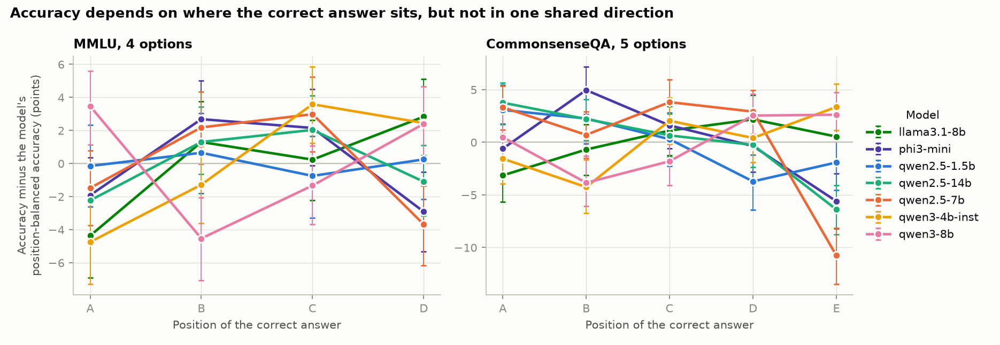
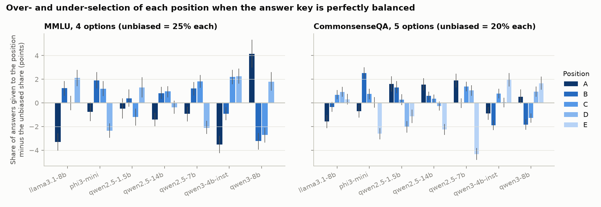
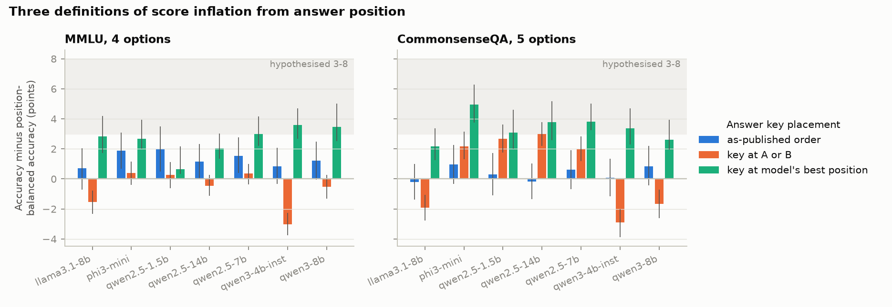
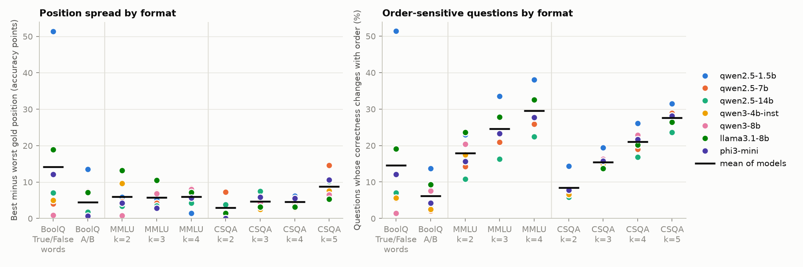
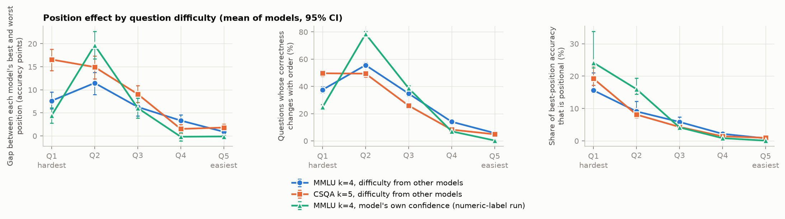

# Positional Bias in Multiple-Choice Benchmarks: How Answer Order Affects LLM Scores

## 1. Executive Summary

**Question.** Do instruct LLMs favour early answer positions (A/B) in multiple-choice questions, and does that
inflate benchmark scores by 3-8 points on 4-option items, more on 5-option items, less on true/false, and most
on medium-difficulty questions?

**Answer.** Mostly no. Across seven open-weight models (1.5B-14B parameters, three families), where the correct
answer sits does change accuracy — by 4-8 points between a model's best and worst position on MMLU for six of
seven models — but the direction differs from model to model, and it is not a general preference for A/B. On
MMLU, five of seven models score below their own average when the key is at A. Scores on the benchmarks as published are
0.3 points (CommonsenseQA) to 1.3 points (MMLU) above position-balanced accuracy, well short of 3-8, and on MMLU
none of that 1.3 comes from where the keys are placed.

Three further results stand out:

- **True/false is not the safest format.** Asking for the word True or False produced the largest order
  effects in the study: 14.2 points on average between the two orders, and 51 points for the smallest model.
- **The effect grows as questions get harder, peaking where the model is near 50% accuracy.** It is close to
  zero on easy questions. "Medium difficulty" in the sense of the middle third of questions is not the peak.
- **The label set matters more than the option count.** Relabelling MMLU options 1-4 instead of A-D more than
  doubled the position spread (5.9 to 13.6 points).

**Two things limit what this supports.** The planned hosted frontier models could not be run: no API key was
present, so every result comes from local open-weight models of 14B parameters or fewer, five of the seven from
the Qwen family. And the pre-gathered literature review, datasets and code were absent, so the background
section is from memory rather than from a reviewed set of papers.

## 2. Research Question & Motivation

The hypothesis as given:

> Models show a consistent bias toward early positions (A/B), inflating scores by 3-8% on 4-option benchmarks.
> The bias is strongest on medium-difficulty questions where the model is uncertain. True/false formats show the
> smallest positional effect (<2%), while 5-option formats show the largest (>10%). Difficulty-stratified
> analysis reveals that positional bias accounts for up to 15% of apparent accuracy on questions near the model's
> decision boundary.

Multiple-choice accuracy is the default way to compare LLMs. If a model's choice depends on where the correct
option is printed, a score partly measures how the benchmark's answer key lines up with the model's habits.

**Background (from memory, not from a gathered review).** Zheng et al. (2024) showed that LLMs have a selection
bias that is largely a preference for particular label *tokens* rather than positions, and proposed cyclic
permutation as a cheap debiasing estimate. Pezeshkpour & Hruschka (2023) reported large accuracy swings from
reordering options. Robinson & Wingate (2023) and Wang et al. (2024) discuss first-token probability read-outs
and where they disagree with generated text. What this study adds is a design in which option count is varied
on the *same* questions, and a difficulty stratification that does not reuse the responses being analysed.

Sub-hypotheses, fixed in `planning.md` before any model was run:

| | Claim |
|---|---|
| H1 | Models over-select early positions (A/B) |
| H2 | On 4-option items this inflates accuracy by 3-8 points |
| H3 | The effect is largest on medium-difficulty questions |
| H4 | True/false shows <2 points; 5-option shows >10 points |
| H5 | Near the decision boundary, up to 15% of apparent accuracy is positional |

## 3. Experimental Setup

### Models

All run locally with HuggingFace `transformers` 5.19.0, `torch` 2.14.1, bfloat16, one RTX A6000 (48 GB) each.

| Tag | HuggingFace repo | Family |
|---|---|---|
| qwen2.5-1.5b | `Qwen/Qwen2.5-1.5B-Instruct` | Qwen |
| qwen2.5-7b | `Qwen/Qwen2.5-7B-Instruct` | Qwen |
| qwen2.5-14b | `Qwen/Qwen2.5-14B-Instruct` | Qwen |
| qwen3-4b-inst | `Qwen/Qwen3-4B-Instruct-2507` | Qwen |
| qwen3-8b | `Qwen/Qwen3-8B` (thinking disabled) | Qwen |
| llama3.1-8b | `unsloth/Meta-Llama-3.1-8B-Instruct` (mirror of Meta's weights) | Llama |
| phi3-mini | `microsoft/Phi-3-mini-4k-instruct` | Phi |

Gemma models were in the cache without tokenizer files and the repository is gated for the available token, so
they were left out.

### Data

| Source | Split | Questions used | Native format |
|---|---|---|---|
| MMLU (`cais/mmlu`, `all`) | test | 1,500, stratified over 57 subjects, seed 42 | 4 options |
| CommonsenseQA (`tau/commonsense_qa`) | validation | all 1,221 | 5 options |
| BoolQ (`google/boolq`) | validation | 1,500 with passage < 1,500 characters, seed 42 | yes/no |

### Conditions

Each question is shown once per **cyclic rotation** of its options, so the correct answer occupies every
position exactly once. Reduced-option versions keep the correct answer plus a seeded, nested sample of the same
question's distractors.

| Condition | Options | Prompts per model |
|---|---|---|
| `mmlu_k4`, `mmlu_k3`, `mmlu_k2` | A-D, A-C, A-B | 6,000 / 4,500 / 3,000 |
| `mmlu_k4_num` | 1-4 (label ablation) | 6,000 |
| `csqa_k5` ... `csqa_k2` | A-E down to A-B | 6,105 / 4,884 / 3,663 / 2,442 |
| `boolq_ab` | "A. True / B. False" and the reverse | 3,000 |
| `boolq_word` | answer with the word; "True or False" vs "False or True" | 3,000 |

Total: 42,594 prompts per model, 298,158 scored prompts overall.

### Prompts

Zero-shot, no system message, each model's own chat template.

```
{question}

A. {option}
B. {option}
C. {option}
D. {option}

Answer with the letter of the correct option only.
```

BoolQ (`boolq_ab` replaces the last line with lettered options and the letter instruction):

```
Passage: {passage}

Statement: The answer to the question "{question}?" is yes.

Is the statement True or False? Answer with one word only: True or False.
```

### Read-out

The log-probability of each label at the first assistant token, summed over every vocabulary token that decodes
to that label with or without leading whitespace. Prediction is the highest-scoring label. No sampling.

### Metrics

With `acc_p` the accuracy when the key is at position p and `bal` their mean (position-balanced accuracy):

- **Spread**: best `acc_p` minus worst `acc_p`.
- **Selection share**: how often each position is chosen. The key is balanced, so an unbiased model chooses
  each position 1/k of the time.
- **Inflation**, three ways: *as-published* (accuracy in the original option order minus `bal`), *early key*
  (mean of `acc_A`, `acc_B` minus `bal`), *best position* (best `acc_p` minus `bal`).
- **Flip rate**: share of questions answered correctly in some rotations and incorrectly in others.
- **Position-attributable share**: best-position inflation divided by best-position accuracy.

### Statistics

95% intervals are percentile bootstraps over questions (2,000 resamples for per-model numbers, 1,000 for
means across models), resampling all rotations of a question together. Cochran's Q tests whether correctness
depends on key position; chi-square tests selection shares against uniform; both Holm-corrected across all 70
model-by-condition cells. A permutation null (position labels shuffled within question, 300 draws) gives the
spread expected from noise alone.

### Cost and time

No API spend. GPU time for the scored runs was about 1.9 hours in total (4 to 29 minutes per model; the machine
was shared, so timings are not comparable across models). Analysis takes about 10 minutes on CPU.

## 4. Results

Raw per-prompt outputs: `results/model_outputs/*.parquet`. Tables: `results/evaluations/`. Full analysis log:
`results/evaluations/analysis_output.txt`.

### 4.1 Four options (MMLU): position matters, but not toward A/B

| Model | Balanced acc. | Key at A | Key at B | Key at C | Key at D | Spread [95% CI] | Noise-only spread | Flip % | Cochran Q p (Holm) |
|---|---|---|---|---|---|---|---|---|---|
| llama3.1-8b | 66.0 | 61.6 | 67.3 | 66.2 | 68.8 | 7.2 [5.2, 9.6] | 1.6 | 32.6 | <0.001 |
| phi3-mini | 68.0 | 66.1 | 70.7 | 70.1 | 65.1 | 5.6 [4.3, 7.7] | 1.5 | 27.7 | <0.001 |
| qwen2.5-1.5b | 56.1 | 55.9 | 56.7 | 55.3 | 56.3 | 1.4 [0.7, 3.9] | 1.7 | 38.1 | 1.000 |
| qwen2.5-14b | 76.0 | 73.7 | 77.3 | 78.0 | 74.9 | 4.3 [2.9, 6.1] | 1.3 | 22.5 | <0.001 |
| qwen2.5-7b | 69.2 | 67.7 | 71.3 | 72.1 | 65.5 | 6.7 [5.1, 8.5] | 1.4 | 25.9 | <0.001 |
| qwen3-4b-inst | 68.4 | 63.7 | 67.1 | 72.0 | 70.9 | 8.3 [6.4, 10.4] | 1.5 | 27.6 | <0.001 |
| qwen3-8b | 67.9 | 71.4 | 63.4 | 66.6 | 70.3 | 8.0 [6.1, 10.3] | 1.6 | 32.5 | <0.001 |

Six of seven models show a position effect well above the noise level. The direction is not shared:

- Key at A is *below* balanced accuracy, with the interval excluding zero, for five models; above it for one
  (qwen3-8b, and see the caveat in 4.7).
- Averaged over A and B, no model gains; two lose (llama3.1-8b -1.5, qwen3-4b-inst -3.0).
- Of the six models with an effect, B or C is the best position for four, D for one and A for one.



Selection shares tell the same story. With a balanced key, llama3.1-8b picks A 21.7% of the time and D 27.1%;
qwen3-4b-inst picks A 21.5% and D 27.3%; qwen3-8b picks A 29.1%. Two models (qwen2.5-1.5b, qwen2.5-14b) are not
distinguishable from uniform.



Each model's pattern replicates across two random halves of the questions (correlation of the four
position accuracies 0.85-0.98 for the six models with a significant effect), so these are stable model traits,
not noise.

### 4.2 How much do scores inflate?

Accuracy minus position-balanced accuracy, in points, with 95% intervals.

| Model | Dataset | As-published order | Key at A or B | Key at best position |
|---|---|---|---|---|
| llama3.1-8b | MMLU k=4 | 0.7 [-0.7, 2.0] | -1.5 [-2.3, -0.8] | 2.8 [1.7, 4.2] |
| phi3-mini | MMLU k=4 | 1.9 [0.7, 3.1] | 0.4 [-0.4, 1.2] | 2.7 [2.0, 4.0] |
| qwen2.5-1.5b | MMLU k=4 | 2.0 [0.5, 3.5] | 0.2 [-0.6, 1.1] | 0.6 [0.3, 2.2] |
| qwen2.5-14b | MMLU k=4 | 1.2 [0.0, 2.3] | -0.5 [-1.1, 0.2] | 2.0 [1.3, 3.0] |
| qwen2.5-7b | MMLU k=4 | 1.5 [0.4, 2.8] | 0.3 [-0.4, 1.0] | 3.0 [2.2, 4.1] |
| qwen3-4b-inst | MMLU k=4 | 0.8 [-0.3, 2.1] | -3.0 [-3.8, -2.3] | 3.6 [2.7, 4.7] |
| qwen3-8b | MMLU k=4 | 1.2 [-0.1, 2.5] | -0.5 [-1.3, 0.3] | 3.5 [2.5, 5.0] |
| **Mean of models** | MMLU k=4 | **1.3 [0.7, 2.0]** | **-0.7 [-1.0, -0.3]** | **2.6 [2.4, 3.2]** |
| llama3.1-8b | CSQA k=5 | -0.2 [-1.4, 1.0] | -1.9 [-2.8, -1.0] | 2.2 [1.3, 3.4] |
| phi3-mini | CSQA k=5 | 1.0 [-0.3, 2.2] | 2.2 [1.3, 3.1] | 5.0 [3.7, 6.3] |
| qwen2.5-1.5b | CSQA k=5 | 0.3 [-1.1, 1.7] | 2.7 [1.8, 3.6] | 3.1 [2.0, 4.6] |
| qwen2.5-14b | CSQA k=5 | -0.2 [-1.3, 1.0] | 3.0 [2.2, 3.8] | 3.8 [2.6, 5.2] |
| qwen2.5-7b | CSQA k=5 | 0.6 [-0.7, 1.9] | 2.0 [1.2, 2.8] | 3.8 [3.2, 5.0] |
| qwen3-4b-inst | CSQA k=5 | 0.1 [-1.2, 1.3] | -2.9 [-3.9, -2.0] | 3.4 [2.3, 4.7] |
| qwen3-8b | CSQA k=5 | 0.8 [-0.4, 2.2] | -1.7 [-2.6, -0.7] | 2.6 [1.9, 3.9] |
| **Mean of models** | CSQA k=5 | **0.3 [-0.3, 1.0]** | **0.5 [0.0, 0.9]** | **3.4 [3.1, 4.0]** |



- **As published**, MMLU scores sit 1.3 points above balanced accuracy on average; CommonsenseQA scores are not
  distinguishable from balanced.
- **If every key were at A or B**, the average model would score slightly *lower* on MMLU. On CommonsenseQA four
  models gain 2-3 points and three lose 2-3.
- **The best case** for each model — every key at the position it favours — is worth 2.0-3.6 points on MMLU for
  the six models with an effect, and 2.2-5.0 on CommonsenseQA. This is the only definition that reaches the low
  end of the hypothesised 3-8 range, and it is biased upward because the best position is picked after the fact
  (noise alone gives 0.6-0.9).

**Where the 1.3 points on MMLU come from.** None of it comes from key placement: weighting each model's
per-position accuracy by MMLU's actual key distribution (A 24.5%, B 23.8%, C 25.1%, D 26.6% in this sample)
predicts a gain of 0.0 [0.0, 0.1]. The whole 1.3 is that the published arrangement is easier than a rotation
with the key in the same slot. Part of that is options that only make sense in their original place ("All of
the above", "Both A and B"): on the 108 questions flagged by a regular expression the as-published advantage is
4.7 [2.4, 7.5] points, against 1.1 [0.5, 1.7] on the other 1,392. The remaining 1.1 points is consistent with
models having seen these items in their original order during training, but this study cannot separate that
from order-dependent options the regular expression missed.

### 4.3 Option count and format

Mean of models, 95% interval. Spread is best-minus-worst position; for two options the best-position gain is
half the spread.

| Condition | Models | Balanced acc. | Spread | Best-position gain | Flip % |
|---|---|---|---|---|---|
| BoolQ, True/False words | 7 | 79.5 | 14.2 [13.5, 15.0] | 7.1 [6.8, 7.5] | 14.6 |
| BoolQ, A/B letters | 7 | 82.3 | 4.4 [4.1, 4.9] | 2.2 [2.0, 2.5] | 6.2 |
| MMLU k=2 | 7 | 81.0 | 6.0 [5.2, 6.8] | 3.0 [2.6, 3.4] | 17.9 |
| MMLU k=3 | 7 | 72.2 | 5.7 [5.0, 6.6] | 2.9 [2.4, 3.3] | 24.6 |
| MMLU k=4 | 7 | 67.4 | 5.9 [5.4, 6.9] | 2.6 [2.4, 3.2] | 29.5 |
| MMLU k=4, labels 1-4 | 6 | 64.7 | 13.6 [12.6, 14.8] | 6.2 [5.7, 6.8] | 37.7 |
| CSQA k=2 | 7 | 91.8 | 2.9 [2.6, 3.7] | 1.5 [1.3, 1.8] | 8.4 |
| CSQA k=3 | 7 | 85.6 | 4.7 [4.0, 5.5] | 2.4 [2.0, 2.8] | 15.4 |
| CSQA k=4 | 7 | 81.4 | 4.6 [4.0, 5.4] | 2.4 [2.1, 2.9] | 21.0 |
| CSQA k=5 | 7 | 77.1 | 8.8 [8.0, 9.9] | 3.4 [3.1, 4.0] | 27.6 |



**True/false.** The spread is under 2 points for one model of seven with word answers (qwen3-8b, 0.9) and four
of seven with A/B letters. It is far above 2 for the rest: with word answers llama3.1-8b is at 18.9, phi3-mini
12.1, and qwen2.5-1.5b 51.4 — that model picks whichever word the instruction mentions first 75.7% of the time,
scoring 90.7% when the truth is mentioned first and 39.3% when it is second. Direction again varies: four
models favour the first-mentioned word, three the second.

**Five options.** The spread exceeds 10 points for three of seven models (qwen2.5-7b 14.6, phi3-mini 10.6,
qwen2.5-14b 10.2) and averages 8.8. On identical questions, going from four to five options raises the spread
by 4.2 [3.3, 4.9] points. The increase is concentrated in one slot: four models are worse when the key
is at E, three of them by 5-11 points (qwen2.5-7b drops 10.8 points below its balanced accuracy there), while both Qwen3 models are *best* at E.

**Option count on its own does not drive the spread.** On MMLU the spread is flat from two to four options
(k=4 minus k=2: 0.0 [-0.9, 1.1]). What rises steadily with option count on both datasets is the flip rate —
more options means more questions whose answer changes with order — but those changes mostly cancel rather
than favouring a position.

### 4.4 Difficulty

Difficulty for a model is the mean position-balanced correctness of the *other six* models on that question, so
it is not computed from the responses being analysed. Mean of models, 95% interval. "Directed gap" is accuracy
at the model's overall best position minus its overall worst.

| Dataset | Stratum | Balanced acc. | Directed gap | Flip % | As-published gain | Position-attributable share % |
|---|---|---|---|---|---|---|
| MMLU k=4 | Q1 hardest | 19.9 | 7.6 [5.9, 9.5] | 37.5 | 1.4 [0.2, 2.5] | 15.6 [14.8, 21.0] |
| | Q2 | 50.0 | 11.5 [9.0, 13.8] | 55.6 | 2.7 [1.3, 4.2] | 9.1 [8.3, 12.2] |
| | Q3 | 76.3 | 6.3 [4.3, 8.2] | 34.8 | 2.5 [1.3, 3.6] | 5.8 [5.1, 7.4] |
| | Q4 | 93.1 | 3.3 [2.1, 4.6] | 14.0 | -0.2 [-0.9, 0.5] | 2.2 [1.8, 3.0] |
| | Q5 easiest | 97.5 | 0.9 [0.1, 1.7] | 5.8 | 0.3 [-0.1, 0.8] | 0.8 [0.7, 1.3] |
| CSQA k=5 | Q1 hardest | 30.0 | 16.6 [14.2, 18.8] | 49.6 | 0.0 [-1.4, 1.7] | 19.2 [17.1, 23.1] |
| | Q2 | 71.9 | 14.9 [12.4, 17.3] | 49.4 | 1.3 [-0.2, 2.6] | 8.1 [7.1, 10.0] |
| | Q3 | 88.9 | 9.1 [7.3, 10.9] | 25.9 | -0.2 [-1.4, 0.8] | 4.3 [3.8, 5.5] |
| | Q4 | 96.7 | 1.5 [0.5, 2.5] | 8.3 | 0.6 [0.1, 1.2] | 1.4 [1.2, 2.1] |
| | Q5 easiest | 98.1 | 1.8 [1.0, 2.6] | 4.9 | 0.0 [-0.4, 0.5] | 0.9 [0.8, 1.4] |



- The position effect is near zero on easy questions and large on hard ones.
- In thirds, the middle third is **not** the peak: hard exceeds medium on directed gap by 3.3 [1.1, 5.7] points
  on MMLU and 7.6 [5.2, 9.9] on CommonsenseQA.
- In fifths on MMLU there is a peak, at the second-hardest fifth, where balanced accuracy is 50%. The hardest
  fifth (20% accuracy, below the 25% chance rate) is lower. On CommonsenseQA the two hardest fifths (30% and 72%
  accuracy) are level.
- Using each model's own confidence from the separate numeric-label run gives a sharper version of the same
  shape on MMLU: the gap is 19.7 [16.7, 22.7] points in the fifth where accuracy is 47%, and 78.5% of those
  questions change correctness with order; it is 4.4 where accuracy is 8% and zero where it is 97% or more.

So the effect tracks uncertainty — it is largest where the model is close to a coin flip between getting the
question right and wrong — and that region is the hard-to-middle part of these benchmarks, not the middle.

**Share of accuracy that is positional.** In the hardest fifth, 15.6% (MMLU) and 19.2% (CommonsenseQA) of
best-position accuracy would disappear under a balanced key; in the hardest third it is 13.0% and 13.4%. For
single models it goes higher (qwen2.5-14b on the hardest CommonsenseQA fifth: 28%). These are best-case figures
with the upward bias noted in 4.2, and the ratios in the hardest strata have small denominators. Measured on the
benchmarks as published, the share is 6.9% [3.5, 10.1] in the hardest MMLU third and indistinguishable from
zero on CommonsenseQA.

### 4.5 Label ablation: 1-4 instead of A-D

Six models (Phi-3 excluded: it emits a whitespace token before a digit, so the first-token read-out carries no
information there).

| Model | Spread, A-D | Spread, 1-4 | Acc. key at first slot minus balanced, A-D | Same, 1-4 |
|---|---|---|---|---|
| llama3.1-8b | 7.2 | 22.8 | -4.4 | -14.2 |
| qwen2.5-1.5b | 1.4 | 10.1 | -0.1 | -3.7 |
| qwen2.5-14b | 4.3 | 11.5 | -2.2 | -6.8 |
| qwen2.5-7b | 6.7 | 7.1 | -1.5 | -0.7 |
| qwen3-4b-inst | 8.3 | 15.6 | -4.8 | -8.9 |
| qwen3-8b | 8.0 | 14.7 | +3.5 | -7.9 |

Same questions, same order, different labels: the mean spread over these six models rises by 7.7 points [6.4, 8.5], to 13.6.
With numerals, all six models are below balanced accuracy when the key is in the first slot — llama3.1-8b scores
48.0% there against 70.8% in the second. The size of the order effect therefore depends heavily on which symbols
label the options, which fits the token-preference account in prior work better than a pure position account.
This study does not separate the two further.

### 4.6 Does the read-out match what models write?

400 MMLU prompts per model were also answered by greedy generation.

| Model | Generated text contains a letter % | Agreement with first-token read-out, when it does % |
|---|---|---|
| llama3.1-8b | 99.8 | 98.2 |
| phi3-mini | 95.2 | 97.6 |
| qwen2.5-1.5b | 97.5 | 99.5 |
| qwen2.5-14b | 99.2 | 99.8 |
| qwen2.5-7b | 100.0 | 98.2 |
| qwen3-4b-inst | 95.5 | 99.7 |
| qwen3-8b | 89.0 | 97.5 |

### 4.7 Robustness and caveats on specific numbers

- **qwen3-8b on MMLU is unreliable in direction.** It puts less than half its first-token probability on any
  letter for at least one rotation of 391 of the 1,500 questions (it starts an explanation instead). On the
  1,109 remaining questions its spread is similar (7.2 vs 8.0) but the sign at position A flips, from +3.5 to
  -3.3. Its apparent preference for A in 4.1 is produced by the questions where it was not going to answer with
  a letter. For the other six models the spread, the as-published gain and the position-A effect each change by under
  1 point under the same filter.
- **Batch-composition noise.** Rerunning qwen2.5-1.5b on 3,000 prompts with different batching reproduced 99.1%
  of predictions; label log-probabilities moved by 0.11 on average. This is bfloat16 arithmetic with padded
  batches. It adds up to about a point to flip rates and is unrelated to position.
- **Analysis reproducibility.** Rerunning `src/analyze.py` reproduces every table exactly (fixed seed).
- **Multiple comparisons.** Cochran's Q is significant after Holm correction in 57 of 70 model-by-condition
  cells (6 of 7 on MMLU k=4, 7 of 7 on CSQA k=5).

## 5. Analysis & Discussion

| | Claim | Verdict | Evidence |
|---|---|---|---|
| H1 | Consistent bias toward A/B | **Not supported** | Position effects are real in 6/7 models but point in different directions; on MMLU 5/7 are below their average at A |
| H2 | 3-8 points inflation on 4-option | **Not supported** | As-published +1.3 [0.7, 2.0], none of it from key placement; A/B key -0.7; best case 2.0-3.6 |
| H3 | Strongest at medium difficulty | **Partly supported** | Strongest where the model is near 50% accuracy; that is the hard-to-middle range, and the middle third is weaker than the hard third |
| H4a | True/false < 2 points | **Not supported** | Mean spread 14.2 (words) and 4.4 (letters); under 2 for 1/7 and 4/7 models |
| H4b | 5-option > 10 points, the largest | **Partly supported** | Spread > 10 for 3/7 models, mean 8.8; larger than 4-option on the same questions, but smaller than true/false words and numeric labels |
| H5 | Up to 15% of accuracy near the boundary | **Supported only as a best case** | 13-19% in the hardest strata if every key sat at the model's favoured position; 7% or less as published |

**Why "inflation" is mostly the wrong word.** A position preference only raises a score when the benchmark's
keys are concentrated where the model likes to answer. MMLU and CommonsenseQA have close-to-uniform keys, so the
preferences largely cancel. What the preferences do produce is *instability*: about 30% of MMLU questions and
28% of CommonsenseQA questions are answered correctly under some option orders and incorrectly under others.
That matters for per-question analyses and for small benchmarks, and it would matter for aggregate scores on
any benchmark with a skewed key.

**Surprises.**
- The simplest format produced the largest effect. With two options there is no averaging over positions, so a
  preference for the first-mentioned word translates directly into accuracy.
- Position A is a disadvantage, not an advantage, for five of these seven models on MMLU.
- The published MMLU order is 1.3 points easier than its rotations for reasons unrelated to where the key is.
  That is a caution for any shuffle-based debiasing: rotating options also damages order-dependent items.

**Comparison with prior work (from memory).** The model-specific direction, the dependence on label tokens and
the growth of the effect with uncertainty match what Zheng et al. (2024) reported for earlier models. Spreads of
4-8 points on MMLU are in the range reported there for open models of this size.

## 6. Limitations

- **Model coverage.** Seven open-weight models, none above 14B parameters, five from one vendor. Frontier hosted
  models were planned and not run (no API key in the environment). Larger models may be less order-sensitive —
  within Qwen2.5 the True/False effect shrinks from 51 to 4-7 points going from 1.5B to 7B/14B — so these
  numbers should not be read as applying to them.
- **No gathered literature.** The resource-finding stage did not run; the background and the comparison with
  prior work are from memory and no paper was re-read for this report.
- **Rotations, not full shuffles.** Cyclic rotation balances key position with k prompts per question but
  covers k of k! orders, and moves order-dependent options ("All of the above") out of place. About 7% of the
  MMLU sample is affected by the latter; the regular expression used to flag them was not validated by hand.
- **Position versus label.** Position and label are tied in every condition except the single A-D versus 1-4
  comparison. The study shows the effect is label-dependent but does not apportion it.
- **First-token read-out.** Agreement with generated text is 97.5-99.8% where the model writes a letter, but
  qwen3-8b and, with numerals, Phi-3 do not reliably start with a label.
- **One prompt template, zero-shot.** Few-shot prompts, other instructions and chain-of-thought answers were not
  tested and are known to change selection behaviour.
- **True/false is one dataset with one unusual phrasing** ("The answer to the question ... is yes"), and
  passage-based. The large word-order effect may not carry over to plain factual true/false statements.
- **Contamination.** MMLU, CommonsenseQA and BoolQ are almost certainly in these models' training data. The
  1.1-point residual advantage of the published MMLU order may reflect this.
- **Best-position figures are biased upward** because the best position is chosen from the same data. The
  noise-only reference (0.6-0.9 points on the full sets) is larger in the smaller difficulty strata.
- **Difficulty from other models** is a property of this particular set of seven and is correlated across the
  five Qwen models.

## 7. Conclusions & Next Steps

Answer order changes what these models answer, but not in the way the hypothesis states. There is no shared
preference for early positions; each model has its own stable pattern, most do worse than their own average at A on MMLU, and because
benchmark keys are close to uniform the net effect on published scores is about one point or less. The effect
is concentrated on questions where the model is close to 50/50, is larger with five options than four because
of the last slot, is largest of all for word-answer true/false in small models, and depends strongly on the
label symbols.

Practical implications for people running evaluations:
- Report position-balanced accuracy (k rotations) when comparing models whose scores differ by a few points.
- Check the answer-key distribution of any new benchmark; a skewed key is where a 2-5 point distortion would
  actually appear.
- Do not assume two-option or true/false items are immune; test both orders.
- Treat per-question correctness as order-dependent for roughly a quarter to a third of items.

Follow-up work, in order of value:
1. Rerun on frontier hosted models with the same items (`datasets/items.parquet` is ready; only the read-out
   needs to change to generated text).
2. Separate label from position with a crossed design (labels permuted independently of slots).
3. Use full random shuffles on the self-contained questions only, to remove the order-dependent-option confound.
4. Test whether the residual advantage of the published MMLU order appears on a benchmark released after the
   models' training cut-offs.
5. Repeat true/false with plain factual statements and several phrasings.

## References

- Hendrycks et al. (2021). Measuring Massive Multitask Language Understanding (MMLU). ICLR.
- Talmor et al. (2019). CommonsenseQA. NAACL.
- Clark et al. (2019). BoolQ. NAACL.
- Zheng et al. (2024). Large Language Models Are Not Robust Multiple Choice Selectors. ICLR.
- Pezeshkpour & Hruschka (2023). Large Language Models Sensitivity to the Order of Options in Multiple-Choice Questions.
- Robinson & Wingate (2023). Leveraging Large Language Models for Multiple Choice Question Answering. ICLR.
- Wang et al. (2024). "My Answer is C": First-Token Probabilities Do Not Match Text Answers in Instruction-Tuned Language Models.
- Miller (2024). Adding Error Bars to Evals.

Citations are from memory and were not checked against the papers during this session.
